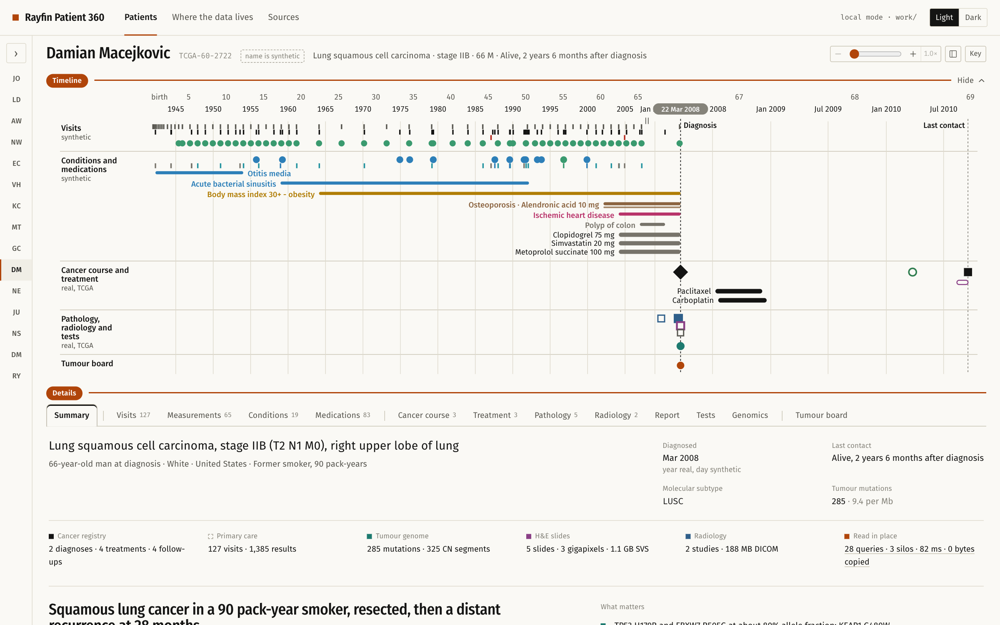
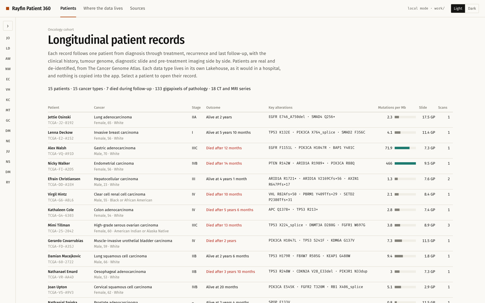
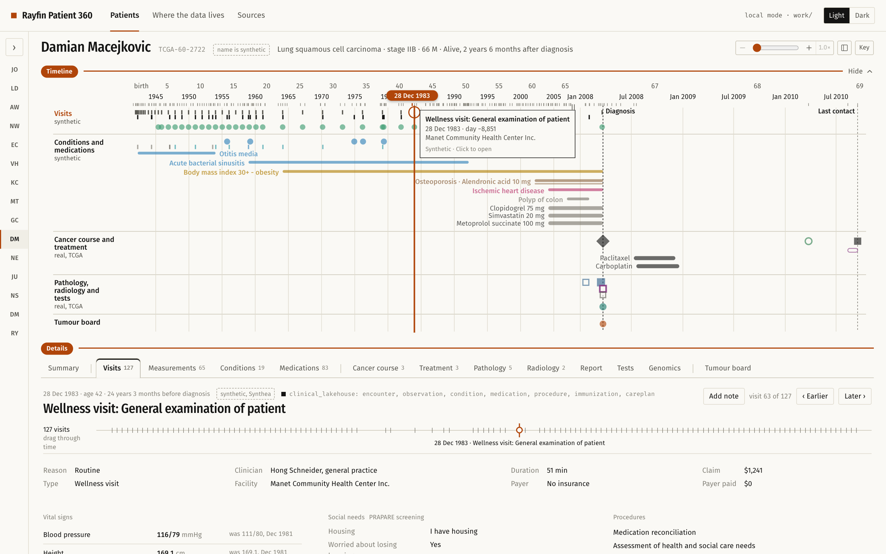
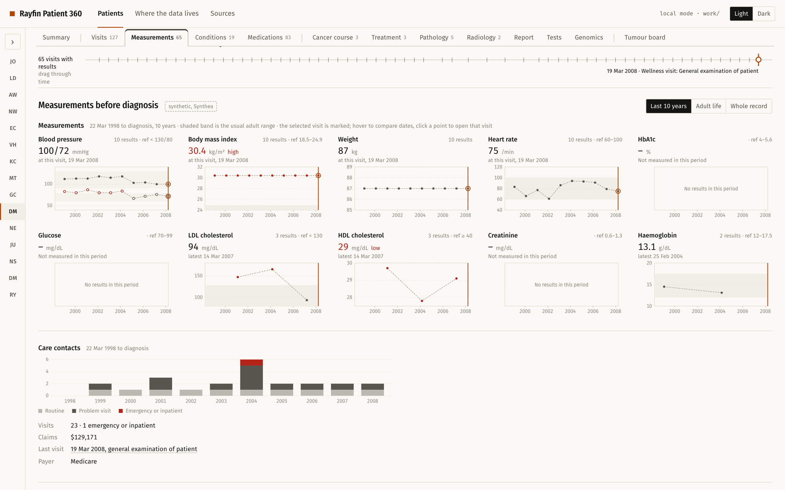
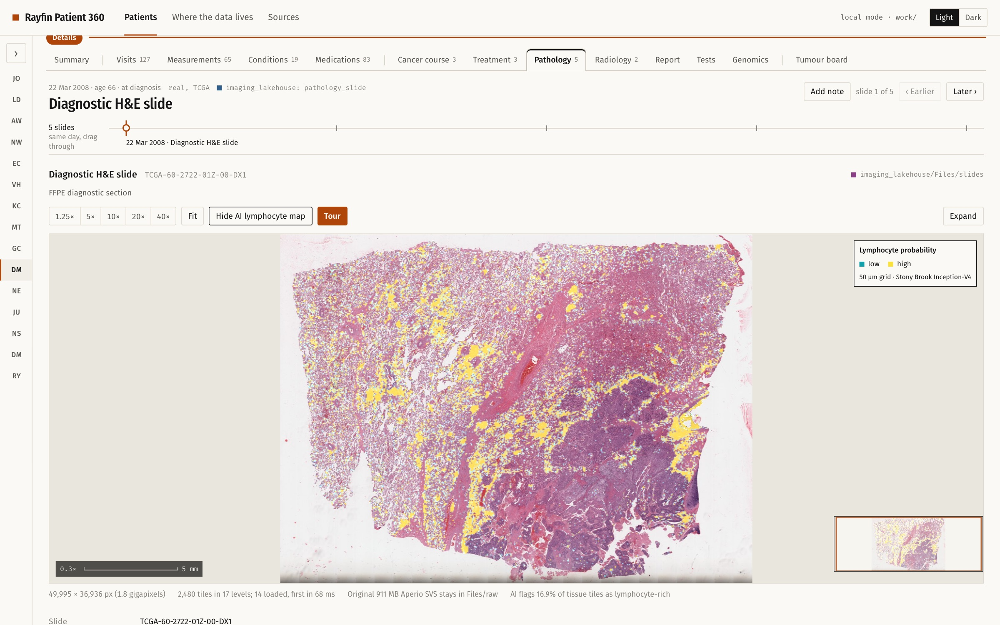
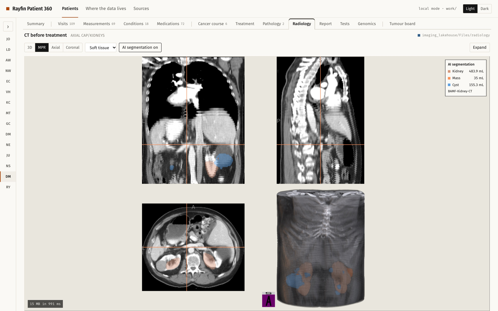
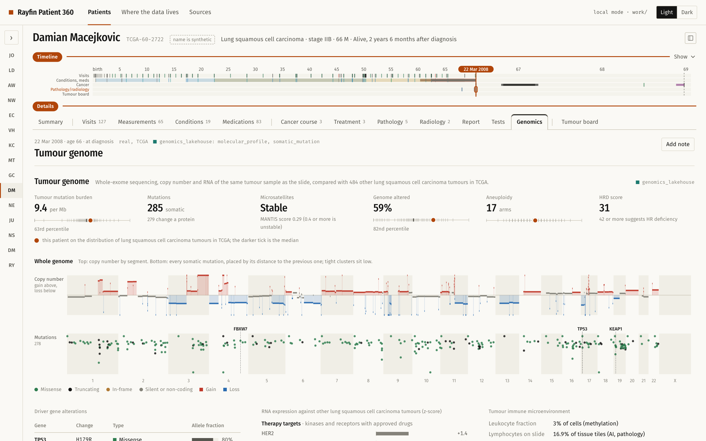
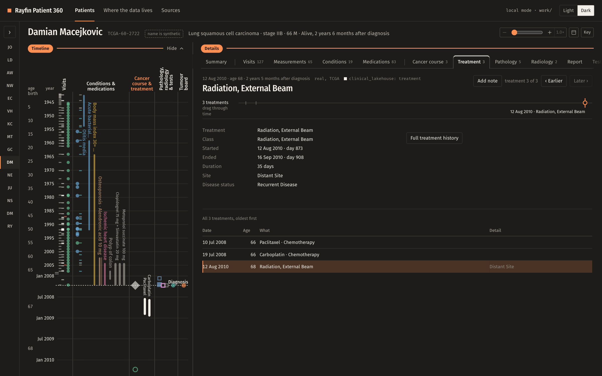
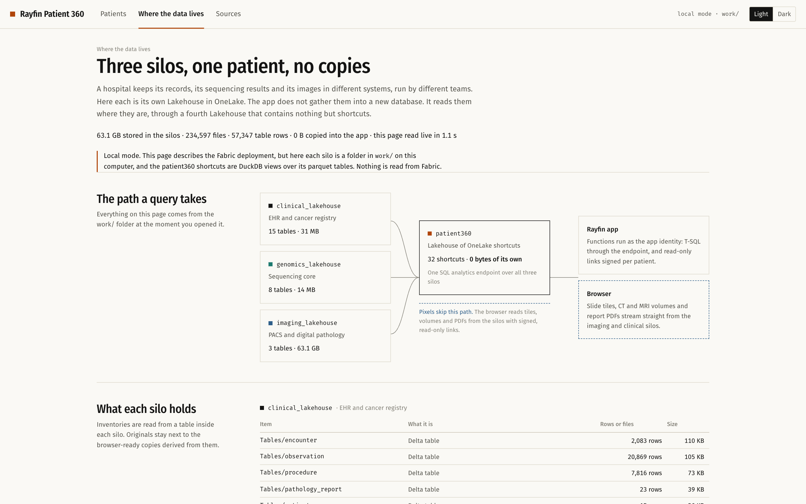

# Patient 360: a multi-modal oncology record on Microsoft Fabric (Rayfin)

A **multi-modal oncology patient record** built as a [Project Rayfin](https://www.npmjs.com/package/@microsoft/rayfin-cli)
app on Microsoft Fabric. For fifteen public, de-identified cancer patients from The Cancer Genome Atlas it puts the
clinical history, the tumour genome, the gigapixel diagnostic slide and the CT or MRI on one screen, around a lifetime
timeline. Each of those lives in its own Lakehouse, as it would in a hospital. The app copies none of it: it reads
the silos in place through a fourth Lakehouse made only of OneLake shortcuts, and pixels stream from OneLake straight
into the browser. It also runs fully on a laptop, without Fabric.

> [!IMPORTANT]
> **For demonstration, education and research only.** This is a demonstration of capability. It is not a medical
> device and must not be used for diagnosis, treatment or any clinical decision. See [Disclaimer](#disclaimer).
>
> **All data is openly available or synthetic.** The patients are public, de-identified research cases (TCGA, via the
> NCI Genomic Data Commons, cBioPortal and NCI Imaging Data Commons). Their names, the day and month of diagnosis and
> their whole primary-care history are synthetic (Synthea). AI outputs, summaries and tumour board notes are
> illustrative.
>
> **This repository hosts no data.** It contains only code, a few screenshots of the app for this README, and short
> demo texts. Every data file is downloaded by the setup pipeline directly from its original public publisher (listed
> under [Data sources](#data-sources)), under that publisher's licence, into your own `work/` folder and Fabric
> workspace.
>
> **Pull requests are welcome** to improve the app, the pipeline or this guide. See [Contributing](#contributing).



## Screenshots

All screenshots are from local mode (`npm run dev:local`), with the same data and code as on Fabric. They show public,
de-identified TCGA data and synthetic names and histories, credited under [Data sources](#data-sources): GDC open
access (clinical, slides, reports), TCIA TCGA collections (CC BY 3.0), the Stony Brook TIL maps and BAMF AIMI
segmentations (CC BY 4.0) via NCI Imaging Data Commons, cBioPortal PanCancer Atlas, and Synthea (synthetic).

**One cohort, three silos, one SQL statement.** Fifteen real TCGA patients, each row joining the cancer registry,
the tumour genome and the imaging archive.



**A whole life on one axis.** Primary-care visits, long-term conditions and their medicines, the cancer course and
treatment, pathology, radiology and tests, and tumour-board notes. Drag the orange date pill and it snaps from event
to event across every lane; the tab below follows.



**Every visit in detail.** Vitals and labs as trend small multiples with adult reference ranges, the selected visit
pinned, and care contacts per year.



**The gigapixel slide, streamed from OneLake.** The 1.8-gigapixel diagnostic H&E slide in deep zoom, with the AI
lymphocyte map over it. Tiles stream from the imaging Lakehouse to the browser through a signed, read-only link.



**CT with AI segmentation.** The pre-treatment CT in coronal, sagittal and axial slices and in 3D, with the
AI-segmented kidneys, mass and cyst and their measured volumes.



**The tumour genome against its peers.** Mutation burden, microsatellite status, genome altered and aneuploidy
placed on the distribution of the same cancer in TCGA; copy number and every somatic mutation across the genome.



**Your layout, light or dark.** The timeline can run down the left beside the tabs; every choice is remembered.



**Where the data lives.** A live inventory of the three silos and the shortcut-only Lakehouse the app reads through:
63 GB in the silos, 0 bytes copied into the app.



## What you get

**Patients** opens on the cohort: one table, produced by a single SQL statement that joins all three silos, with
cancer, stage, outcome, key alterations, tumour mutation burden, slide size and scans. Pick a patient to open their
record: the **lifetime timeline** runs across the top with the record's **tabs** below it, or down the left with the
tabs beside it (toggle in the timeline's toolbar; the choice is remembered). The patient list folds to a rail of
initials (expand it with the arrow); switching patient keeps the open tab.

- **Lifetime timeline**: the whole life on one axis, from birth to last contact or death, with age and year, and the
  cancer course expanded. Five lanes:
  - **Visits** (synthetic): wellness visits grey, office visits dark, emergency and inpatient stays red;
    immunisations as green dots.
  - **Conditions and medications** (synthetic): one row per long-term condition, as a solid line coloured by body system and named beside it in the same colour
    (heart and circulation, metabolic, ear-nose-throat and lungs, kidney-bladder-pregnancy, mental health and sleep,
    bones and injury, mouth and teeth), with the medications that treat it drawn as a thinner line just beneath
    and named after it. Acute conditions are dots on their own row and short courses of medication ticks on a
    *short courses* row, in the colour of what they treat.
  - **Cancer course and treatment** (real): diagnosis, metastasis, recurrence, tumour-free and death; surgery and
    radiation; one row per drug, coloured by class (targeted therapy in teal), named beside its bar.
  - **Pathology, radiology and tests**: radiology studies, pathology slides, the pathology report, tests and the
    tumour genome.
  - **Tumour board**: notes at the event they are about.

  The record reads as two chapters, each opened by an orange rule with a pill: *Timeline* (the chart, indented
  under its rule, with its controls at the right of the patient's name) and *Details* (the tabs). Hovering the chart
  shades the lane and the time column under the pointer. *Hide* on the Timeline rule folds it to a strip.
  **The date pill is a picker**: drag it (or the orange line under it) along the axis and it snaps from event to event across every lane, with a
  small click at each notch (events on the same day are fanned out so each has a notch); the tab below follows,
  showing each event as you pass it. Hovering the pill or its line lifts the pill, ready to pick up. Arrow keys step it when it has focus. It works in the collapsed strip too. The
  **scroll wheel zooms** around the pointer; shift + wheel or a sideways swipe pans when zoomed. The controls: zoom (−, slider, + and the zoom factor; press the factor to see
  the whole life again), one button that moves the timeline to the top or the left, *Key* (every colour and shape)
  and collapse. Zoom also by
  dragging along the timeline or with a trackpad pinch; when zoomed, a strip beside the plot shows and moves the
  window. **Give a lane more room** by dragging the divider beside its name, or double-click the name (again to
  share the space evenly); the sizes are remembered. **Collapse** the timeline to a thin strip (one row per lane,
  still showing the selection and still clickable) when a slide or scan needs the screen. The divider between
  timeline and tabs can be dragged (double-click resets it).
- **Tabs**: Summary · Visits · Measurements · Conditions · Medications (and immunisations) · Cancer course ·
  Treatment · Pathology · Radiology · Report · Tests · Genomics · Tumour board, in the order of the timeline's
  columns, each with its item count.
- **Everything is synchronised.** Clicking a mark on the timeline opens its tab with that item; stepping through a
  tab (*Earlier* and *Later*, the arrow keys, the slider under the title, or the full list at the bottom) moves the
  timeline's selection line. The open tab's columns are highlighted on the timeline and everything else fades. The
  tab and the selected event are in the URL (`?tab=visits&e=v:<encounter>`), so a view can be shared and Back works.
  Each tab opens on its latest item and remembers where you were.
- Every item says whether its data is real or synthetic, and which silo and tables it came from. A visit shows the
  reason, clinician, facility, payer and claim, vitals and labs by panel with reference flags and the previous value,
  screening scores (PHQ-9, GAD-7, AUDIT-C), social needs, and the diagnoses, prescriptions, procedures, vaccines and
  care plans from that visit. A condition shows its episodes, visits, treating medicines and the related lab trend,
  and a medicine shows every prescription.
- **Summary**: who the patient is (age, sex, race, country, smoking), the cancer and stage, outcome, subtype and
  tumour mutations; one line per modality with its size; then a headline, a short narrative and five sourced points
  ("what matters"), each tagged with the modality it comes from, written at build time from the stored fields only;
  then primary care at diagnosis (synthetic): problem list, medicines, allergies, lifestyle and screening,
  immunisations. *Read in place* opens a drawer listing every query that built the page,
  which silo it read, rows and milliseconds, the cross-silo SQL, and the signed file links.
- **Pathology**: every H&E slide for the patient in deep zoom (OpenSeadragon): the diagnostic FFPE section and the
  frozen sections cut from the top and bottom of the tissue that was sequenced (and of adjacent normal tissue where
  TCGA has it), 38 slides in all, each a mark on the timeline. Magnification presets, a scale bar, a guided tour of
  cell-dense and lymphocyte-rich regions, and on the diagnostic slide the **AI lymphocyte map** (Saltz et al.,
  Stony Brook Inception-V4) laid over the tissue on its 50 µm grid.
- **Radiology**: the CT or MRI in 3D, MPR or single planes (NiiVue), with CT transfer functions, a cut plane, spin,
  and **AI segmentations** (kidney mass and cysts, liver, lungs and nodule) with measured volumes; step between
  scans on the timeline or in the tab. The slide and CT viewers stay loaded when you switch tabs.
- **Tumour genome**: tumour mutation burden, genome altered and aneuploidy placed on the distribution of the same
  cancer type in TCGA; microsatellite status and HRD score; a whole-genome plot (copy number by segment, and every
  somatic mutation as a rainfall plot, which makes a POLE-ultramutated tumour unmistakable); driver alterations
  with allele fractions and the clinical tests that confirm them; RNA expression of therapy targets, ADC targets,
  immune checkpoints and DNA-repair genes against the cancer type; and the immune microenvironment (leukocyte
  fraction, CIBERSORT cell mix and T-cell clones, from the Thorsson 2018 data files on the GDC).
- **Cancer registry**: histology, ICD-10, TNM, grade, Gleason, margins, Child-Pugh and fibrosis, other primary
  cancers, recurrence sites; treatment by day with outcome and radiation dose; risk factors, occupation, BMI,
  performance status, and tests at diagnosis (AFP, PSA, CEA, pulmonary function, blood counts).
- **Pathology report**: the scanned PDF from the GDC next to its OCR text, with diagnosis, grade, size, margins,
  nodes and invasion highlighted. The scan is drawn page by page with PDF.js rather than the browser's PDF plug-in,
  which is blocked inside the Fabric portal and in many managed browsers; a page slider follows the scroll. GDC has
  one report per patient.
- **Measurements** (synthetic, marked as such), for the last 10 years, adult life or the whole record: ten
  measurement charts with year and value axes, the usual adult range shaded and out-of-range results marked (blood
  pressure, BMI, weight, heart rate, HbA1c, glucose, LDL, HDL, creatinine, haemoglobin). The selected visit is
  pinned on every chart; hovering lines up another date across all charts, and clicking a point selects that
  visit. Below, visits per year by type with claims and payer.
- **Tumour board**: the only data the app writes, stored in the app's own Rayfin database. A note is about an event
  on the timeline (or the case as a whole) and sits at that event in the Notes column; *Add note* on any item starts
  a note about it, and the item shows how many notes are about it. When a patient has no notes, the tab offers to add the
  demo's case-review note for that patient (from `pipeline/tumour_board_notes.json`), written from facts in the
  record and labelled *illustrative, written for the demo*.

**Where the data lives** reads, live, what each silo stores (tables, rows, files, bytes), lists the shortcuts in
`patient360` from the Fabric REST API, and draws the read path. **Sources** lists every dataset with its licence and
citation, and says exactly what is real and what is generated.

## The cohort

Fifteen de-identified TCGA patients, one per cancer type. Each has a clinical record, a sequenced tumour, a diagnostic
slide, a pre-treatment scan in NCI Imaging Data Commons and a pathology report. They are ordered for the demo.

| Patient | Cancer | Why this patient |
|---|---|---|
| TCGA-J2-8192 | Lung adenocarcinoma | EGFR exon 19 deletion in a never-smoker with three prior cancers; erlotinib at recurrence; AI lung and nodule segmentation |
| TCGA-E2-A152 | Breast, HER2-enriched | ERBB2 amplified and IHC 3+, trastuzumab; liver and bone metastases at day 54 and 83, tumour-free at 5.8 years |
| TCGA-VQ-A91D | Gastric, MSI-high | Truncating MLH1, 2,141 mutations (72 per Mb); died at day 356 |
| TCGA-FI-A2D5 | Endometrial, POLE | POLE V411L, 13,853 mutations (466 per Mb, 99th percentile), synchronous lung cancer |
| TCGA-DD-A1EH | Liver, hepatitis B | Aged 23, AFP 94,340 ng/mL; AI liver volume 1,896 mL before and 1,049 mL after resection |
| TCGA-G6-A8L6 | Clear cell kidney | VHL, PBRM1, SETD2 truncations (3p); sunitinib, axitinib, bevacizumab in ten months |
| TCGA-G4-6303 | Colon | KRAS wild-type, five lines over 5.5 years including cetuximab; prone CT colonography |
| TCGA-25-2042 | Ovarian, high-grade serous | Progressed on platinum; three CT scans across treatment |
| TCGA-FD-A3SJ | Bladder | BCG for prior non-invasive disease, 40 pack-years, electrical installer; HRD 55 |
| TCGA-60-2722 | Lung squamous | 90 pack-years; SOX2/TP63 amplified, CDKN2A deleted; most lymphocyte-rich slide |
| TCGA-VR-AA4D | Oesophageal adenocarcinoma | Reflux disease; ERBB2 amplified with no HER2 therapy on record |
| TCGA-VS-A9V3 | Cervical squamous | Complete response to chemoradiation and brachytherapy, then nodal relapse; PD-L1 RNA high |
| TCGA-J4-A6G3 | Prostate | Gleason 8, SPOP F133V, positive margins, biochemical recurrence |
| TCGA-G7-A8LE | Papillary kidney | MET Y1230H; AI segmentation of kidneys, mass and cysts; tumour-free at 6.7 years |
| TCGA-KM-8441 | Chromophobe kidney | AI-measured 49 mL mass; MTOR I2017T; a second kidney primary |

## What is real, and what is synthetic

- **Real** (public, de-identified): diagnoses, staging, treatments, follow-up, tests, exposures and family history
  (GDC); somatic mutations, copy number, RNA and subtypes (cBioPortal, PanCancer Atlas); immune landscape (Thorsson
  2018 data files on the GDC); diagnostic slides and pathology report PDFs (GDC); report text (TCGA-Reports); CT and MRI, AI TIL maps and
  AI segmentations (TCIA via Imaging Data Commons).
- **Synthetic**: display names (from Synthea); the day and month of diagnosis (the GDC publishes the year, and every event as days
  from diagnosis, so intervals are real); radiology dates are aligned so the baseline scan falls one week before
  diagnosis (TCIA keeps the real intervals between scans); the primary-care history before diagnosis (Synthea).
- **Written for the demo**: the patient summaries (`pipeline/summaries.json`) were drafted by an AI assistant (GitHub
  Copilot) from the stored fields and checked against them; the tumour board notes (`pipeline/tumour_board_notes.json`)
  are illustrative. Both are stored in the app as written text, labelled as such. Neither is a clinical opinion. The app is for education and research
  only and is not for clinical use (see [Disclaimer](#disclaimer)).

The Synthea background is matched on sex and age, ends on the day of diagnosis, contains no cancer of any kind, uses
the real smoking history instead of its own, and has height and weight scaled to the real values. Injury and dental
vignettes and social-determinant surveys are dropped. Everything synthetic is drawn dashed and labelled.

## Setup guide for an AI agent

These steps are written so an AI coding agent (or a person) can take a fresh clone to a working app in the user's own
Fabric tenant, or to local mode on a laptop. Run them in order from the repository root. Each step says what to check
before moving on.

### Step 0 — Ask the user (do not guess)

Ask these questions and wait for the answers before running anything that touches Fabric:

1. **Fabric, or local mode only?** Local mode (steps 1, 2, 5, 6 without uploads, then [local mode](#run-it-on-your-laptop-without-fabric-local-mode))
   needs no Fabric capacity, Azure login or sign-in.
2. **What is the name of the Fabric workspace to deploy into?** It holds the four Lakehouses and the app.
3. **Does that workspace already exist?** If not, **which Fabric capacity should it use?** Step 4 lists the
   capacities the user can see. Any paid capacity (F2 or larger) or a trial works.
4. **Include the frozen-section slides?** They add 23 slides and about 5 GB to download (`--tissue-slides`).

The full download is about 34 GB (mostly the whole-slide images), `work/` grows to about 60 GB, and OneLake holds
about 64 GB with the original files (`--skip-raw` leaves those out). Tell the user that signing in (steps 3 and 7)
opens a browser window they must complete themselves.

### Step 1 — Check prerequisites

| Tool | Version | Check |
|---|---|---|
| Node.js | 20, 22 or 24 (the Rayfin CLI supports these) | `node -v` |
| Python | 3.11 or newer | `python3 --version` |
| Java | 17 or newer (Synthea) | `java -version` |
| Azure CLI | any recent (Fabric only) | `az version` |
| AzCopy | v10 (Fabric only) | `azcopy --version` |
| Disk space | about 70 GB free | |
| Fabric | a workspace on an **active** capacity; Fabric Apps (Rayfin) enabled in the tenant | |

The tenant setting **"Use short-lived user-delegated SAS tokens"** (Fabric admin portal, OneLake settings) lets the
browser stream slides, volumes and PDFs straight from OneLake. Ask a Fabric admin to enable it if it is off.

### Step 2 — Install dependencies

```bash
npm install
(cd rayfin/functions && npm install)
python3 -m venv .venv
.venv/bin/pip install -r pipeline/requirements.txt
```

Check that `npx rayfin --version` prints a version and that `.venv/bin/python -c "import openslide, SimpleITK, idc_index"`
exits cleanly.

For the [Azure loader](#steps-56-on-azure-instead-optional), replace the Python requirements install above with
`.venv/bin/pip install azure-identity requests cryptography`. Skip the imaging-import check. Java, AzCopy, the imaging
libraries and the large data files stay on the VM. Node.js, Python, Git and Azure CLI are still needed on your machine.
On Windows, use `.venv\Scripts\python.exe` and `.venv\Scripts\pip.exe` instead of `.venv/bin/python` and `.venv/bin/pip`.

### Step 3 — Sign in (Fabric only)

```bash
az login                 # used by the setup script, AzCopy and the Delta table loads
npx rayfin login         # used by `rayfin up`; opens a browser account picker
```

Use the same account for both. It must be able to create items in the target workspace (Admin, Member or
Contributor).

### Step 4 — Prepare the workspace and Lakehouses (Fabric only)

```bash
# Look first (read-only): the workspace, its capacity and which Lakehouses exist.
.venv/bin/python scripts/setup_fabric.py --workspace "<workspace name>" --dry-run

# Existing workspace:
.venv/bin/python scripts/setup_fabric.py --workspace "<workspace name>"

# New workspace (the error message from --dry-run lists the capacity IDs you can use):
.venv/bin/python scripts/setup_fabric.py --workspace "<workspace name>" --create --capacity-id <capacity GUID>
```

The script finds or creates the workspace, assigns a capacity if it has none, creates `clinical_lakehouse`,
`genomics_lakehouse`, `imaging_lakehouse` and `patient360`, waits for `patient360`'s SQL analytics endpoint, and
writes the IDs to three places. Keep these deployment-specific values out of commits:

- `fabric.env` at the repository root, read by `pipeline/upload_onelake.py`
- the `<fabric-config>` block in `rayfin/functions/src/function_app.ts`, used by the deployed functions
- `.env.production.local`, the workspace link in the app header

If it reports that the capacity is paused, ask the user to resume it in the Azure portal, then run it again.

### Step 5 — Download the public data

Everything lands in `work/`, which is git-ignored. Downloads skip files that already exist, so they can be re-run.

```bash
.venv/bin/python pipeline/download_sources.py           # TCGA-Reports, the PanImmune files from the GDC, the Synthea jar (~210 MB)
.venv/bin/python pipeline/download_imaging.py           # diagnostic slides from the GDC (~27 GB), CT/MR, AI SEG and TIL maps from IDC (~2.1 GB)
.venv/bin/python pipeline/download_imaging.py --tissue-slides   # optional: the frozen sections (~5 GB)
.venv/bin/python pipeline/fetch_clinical_genomics.py    # clinical records and report PDFs (GDC), genomics (cBioPortal)
```

- **Cohort:** the fifteen patients and their scans are pinned in `pipeline/cohort.json`. `select_cohort.py` shows how
  they were chosen; you do not need to run it.
- **Licences:** the GDC queries request open-access files only, and the IDC queries keep only series whose licence
  allows commercial use (CC BY).
- **Nothing is converted at this step:** files are kept as published, under `work/raw/`.

### Step 6 — Build, upload and register the data

```bash
.venv/bin/python pipeline/build_synthea.py              # synthetic primary-care history, matched to each patient
.venv/bin/python pipeline/build_slides.py               # Deep Zoom pyramids + AI TIL overlays (~15 min on 16 cores)
.venv/bin/python pipeline/build_slides.py --tissue      # only if you downloaded the frozen sections
.venv/bin/python pipeline/build_radiology.py            # NIfTI volumes + AI label maps
.venv/bin/python pipeline/build_tables.py               # typed tables per silo; also loads pipeline/summaries.json
.venv/bin/python pipeline/upload_onelake.py             # Fabric only: Files, Delta tables, inventories, shortcuts
```

- **`--skip-raw`:** `upload_onelake.py` also copies the original SVS and DICOM files into `Files/raw/` for lineage.
  Add `--skip-raw` to save about 34 GB of OneLake storage.
- **Check:** in Fabric, `patient360` shows 32 shortcuts and its SQL analytics endpoint lists the tables.

### Steps 5–6 on Azure instead (optional)

Steps 5 and 6 move about 35 GB and tile the slides, which can take many hours on a small machine or slow connection.
`scripts/cloud_load.py` runs them on a temporary Azure VM that loads straight into OneLake. The other steps stay where
they are: prepare Fabric with step 4, run the loader instead of steps 5 and 6, then deploy Rayfin with step 7 and check
the app with step 8. `pipeline/run_all.py` runs steps 5 and 6 locally when you prefer that path.

The VM reuses the existing Python, Java, native imaging libraries and AzCopy pipeline without a Spark rewrite or
competing with the app for Fabric compute. Fabric notebooks are an alternative for recurring workloads, but need
separate validation of these dependencies, scratch disk and capacity; they are not a drop-in replacement here.

Before you start:

- Complete steps 2 through 4 with the same tenant for Azure and Fabric. You must be **Admin** of the workspace;
  [Fabric requires Admin to remove workspace roles](https://learn.microsoft.com/en-us/rest/api/fabric/core/workspaces/delete-workspace-role-assignment).
- You need Azure permissions to create and delete the resource group, VM, network, disk and shutdown schedule, and
  to invoke VM Run Command. The Fabric tenant setting *Service principals can use Fabric APIs* must cover the VM's
  managed identity. The loader does not change tenant settings.
- Choose a region and an available x64 VM size with enough vCPU quota. The defaults are Ubuntu 24.04,
  `Standard_D16s_v5` and a 256 GB OS disk. Prefer the Fabric capacity's region. Azure policy must allow a public IP
  for outbound access; this version does not configure private endpoints or bypass policy.
- Push the commit to a trusted public HTTPS repository. The VM clones `origin` at your current commit; uncommitted changes
  are not copied. Use `--repo` and `--ref` for another public fork and pushed commit. Do not put credentials in the URL.
  The VM explicitly fetches the requested ref before checking it out, including commits published only through a
  pull-request ref. The ref must be fetchable from the selected repository; use `--repo` for an unsubmitted fork.

**Use a dedicated demo workspace.** The existing uploader overwrites the demo tables and same-name shortcuts.
Cleanup removes temporary Azure resources and access, not data already written to Fabric.

```bash
az login
az account set --subscription "<subscription-id>"

# Run the default diagnostic-slide load.
.venv/bin/python scripts/cloud_load.py up --location "<region>"

# Alternative: include frozen sections and omit raw imaging from OneLake.
.venv/bin/python scripts/cloud_load.py up --location "<region>" -- --tissue-slides --skip-raw

# If you interrupted the wait, inspect the run and clean up when finished.
.venv/bin/python scripts/cloud_load.py status
.venv/bin/python scripts/cloud_load.py down
```

Choose one `up` command, not both. `--skip-raw` saves OneLake storage; it does not skip the downloads needed to build
the images. Use `--resource-group "<name>"` on **all three commands** for a name other than `p360-loader`. Select the
same Azure subscription before later `status` or `down` commands. An existing resource group is never reused by `up`.

The VM uses its own managed identity and has no public inbound ports. Your Azure and Rayfin credentials stay on
your machine. The loader discards the private SSH key and manages the VM through Azure Run Command. It records
`p360-loader`, `p360-workspace` and `p360-principal` tags on its resource group before granting Fabric access.
Do not edit these tags or add unrelated resources to that group.

`up` waits for completion and calls `down` on success. A failed stage, failed shortcut result, boot error or timeout
leaves the group intact for inspection. `status` shows the state and a bounded log tail. Runs are not automatically
resumed after failure or reboot: inspect the error, run `down`, then start a fresh run. The shared local runner can
reuse files that its individual pipeline scripts already know how to skip.

`down` uses the recorded workspace and principal, even if `fabric.env` changes or the VM was deleted separately.
It deletes the principal's workspace assignments by assignment ID and verifies their removal before deleting the
resource group. Failed cleanup stops with an error; resolve it and retry `down`. The Fabric capacity, Lakehouses and
Rayfin app remain in place.

**Cost control:** the VM has an auto-shutdown time about six hours after provisioning. Downloads can dominate runtime.
Shutdown stops VM compute, but disk, public IP and Fabric charges remain. If you close the controller or interrupt
its wait, it cannot perform automatic cleanup; run `down` yourself. See Azure pricing for your chosen region and size.

For code changes, run the focused checks with the full `pipeline/requirements.txt` installed:

```bash
python -m unittest discover -s scripts -p "test_cloud_load.py"
python -m unittest discover -s pipeline -p "test_upload_onelake.py"
```

These checks use mocked cloud APIs. With Bash installed, they also execute the Linux status script against local
fixtures. They do not replace a live run in a disposable demo workspace and the app checks in step 8.

### Step 7 — Deploy the app (Fabric only)

```bash
npx rayfin up -w "<workspace name>" -y
```

`rayfin up` creates the Rayfin app item, its database (tumour board notes), the functions and the static site.

- **Check:** the command ends with *"Your app is live at: https://…fabricapps.net"*. Give that URL to the user. It
  needs Fabric (Entra) sign-in.
- **`rayfin.yml`:** the first deploy appends the hosting URL to `rayfin/rayfin.yml` (`allowedRedirectUris`). Keep it
  locally, but do not commit it to a public fork.
- **Redeploying:** after a code change, run `npx rayfin up -w "<workspace name>" -y` again.

### Step 8 — Verify

Open the URL, sign in and check:

- **Patients:** fifteen patients; *Show the SQL* shows one statement over three Lakehouses.
- **A record:** the timeline draws; Pathology zooms into the slide; Radiology renders the CT or MRI; Genomics draws the
  genome plot; Report shows the scanned PDF.
- **Where the data lives:** three silos with sizes, and the 32 shortcuts listed live from the Fabric API.
- **Tumour board:** *Add the illustrative case-review note* adds the demo note for that patient.

If the app says it could not read the data, check that step 4 wrote the IDs before step 7 ran, and that the deploying
account (the app identity) can read the workspace.

### Troubleshooting

| Symptom | Fix |
|---|---|
| `rayfin` errors about the Node version | Use Node 20, 22 or 24. |
| `CapacityNotActive` or "capacity is paused" | Resume the capacity in the Azure portal. |
| The app says "Fabric is not configured" | Run step 4, then redeploy (step 7). |
| The first patient takes several seconds | The SQL analytics endpoint was idle. Open the cohort once before presenting. |
| Slides, scans or PDFs do not load on Fabric | Enable the tenant setting "Use short-lived user-delegated SAS tokens". |
| A GDC or IDC download fails | Re-run the same script: downloads resume and retry. Both are public and need no login. |
| `upload_onelake.py` says WORKSPACE_ID is missing | Run step 4, or export the variables listed in `pipeline/fabric_config.py`. |
| `build_synthea.py` fails to start | Install Java 17 or newer, and run `download_sources.py` for the Synthea jar. |
| Synthetic names differ from the screenshots | Synthea's latest build changed; the TCGA data is the same. |

---

## Data sources

All data is public, de-identified or synthetic, and is downloaded from its publisher at setup time. **This repository
contains none of it.** Every source below allows reuse with attribution, including commercial use. Check the current
terms at each source before you rely on them.

| Dataset | Used for | Licence | Downloaded by | Size |
|---|---|---|---|---|
| [The Cancer Genome Atlas](https://portal.gdc.cancer.gov/) via the NCI Genomic Data Commons (open-access tier) | clinical records (diagnoses, treatments, follow-up, tests, exposures), diagnostic and frozen-section H&E slides (SVS), scanned pathology reports (PDF) | NIH GDC open access; cite the TCGA Research Network | `download_imaging.py`, `fetch_clinical_genomics.py` | 32 GB |
| [TCGA PanCancer Atlas](https://gdc.cancer.gov/about-data/publications/pancanatlas) via [cBioPortal](https://www.cbioportal.org) | mutations, copy number, GISTIC calls, structural variants, RNA z-scores, subtype, TMB, MSI, aneuploidy, and the per-cancer distributions | TCGA open access | `fetch_clinical_genomics.py` (cBioPortal API) | 10 MB |
| [The Immune Landscape of Cancer](https://gdc.cancer.gov/about-data/publications/panimmune) data files, on the GDC | leukocyte fraction, immune signature scores, CIBERSORT cell fractions, TCR richness, HRD score | NIH GDC open access | `download_sources.py` | 13 MB |
| [TCGA-Reports](https://doi.org/10.17632/hyg5xkznpx.1) (Mendeley Data) | OCR text of the pathology reports | CC BY 4.0 | `download_sources.py` | 10 MB |
| TCIA TCGA radiology collections via [NCI Imaging Data Commons](https://portal.imaging.datacommons.cancer.gov/) | pre-treatment CT and MRI (DICOM) for 15 patients | CC BY 3.0 | `download_imaging.py` | 2.1 GB |
| [BAMF AIMI annotations](https://doi.org/10.5281/zenodo.8345959) via IDC | AI segmentations: kidneys, mass and cysts; liver; lungs and nodule | CC BY 4.0 | `download_imaging.py` | 16 MB |
| [RCC-AID](https://doi.org/10.5281/zenodo.22284133) via IDC | AI kidney, mass and cyst segmentation (one patient) | CC BY 4.0 | `download_imaging.py` | 2 MB |
| [TCGA TIL maps, Stony Brook](https://doi.org/10.5281/zenodo.16966285) via IDC | AI lymphocyte maps on the diagnostic slides | CC BY 4.0 | `download_imaging.py` | 4 MB |
| [Synthea](https://github.com/synthetichealth/synthea) | the synthetic primary-care history and display names | Apache-2.0 (software); its output is synthetic | `download_sources.py`, `build_synthea.py` | 190 MB |

- **Pinned:** the patients, series and dates are pinned in `pipeline/cohort.json`; the source files and their
  checksums in `pipeline/download_sources.py`.
- **Filtered by licence:** the GDC queries request open-access files only, and the IDC downloads keep only series whose
  licence allows commercial use (CC BY; no NC or ND).
- **Left out on purpose:** the immune subtypes (C1–C6), neoantigen counts and other columns of the Thorsson et al.
  2018 supplementary table are not used, because the journal publishes that table under a non-commercial licence.
  The values the app shows come from the study's own data files on the GDC, which match the table.
- **Credited in the app:** each dataset's citation is on the **Sources** page, and under
  [Data attribution](#data-attribution).

## Open-source software

The app and pipeline use only open-source software:

- **Viewers:** [OpenSeadragon](https://openseadragon.github.io/) (BSD-3-Clause), [NiiVue](https://github.com/niivue/niivue)
  (BSD-2-Clause) and [PDF.js](https://mozilla.github.io/pdf.js/) (Apache-2.0).
- **UI:** React, React Router, Radix UI, shadcn/ui, Tailwind CSS (all MIT) and D3 (ISC).
- **Fonts:** Fira Sans, Fira Sans Condensed and Fira Mono, via @fontsource (SIL OFL 1.1).
- **Local mode:** DuckDB (MIT).
- **Fabric SDK:** the Rayfin SDK and CLI packages (`@microsoft/rayfin-*`, `@microsoft/fabric-user-data-functions`) are
  MIT-licensed on npm, as are the agent skills they generate under `.agents/skills/`.
- **Python pipeline:** OpenSlide (LGPL-2.1, used as an unmodified library), SimpleITK (Apache-2.0), pydicom, nibabel
  and idc-index (MIT), NumPy, SciPy and pandas (BSD), Pillow (MIT-CMU), delta-rs (Apache-2.0), and the Azure SDKs
  (MIT). Synthea (Apache-2.0) runs as a downloaded Java program.
- **Audit:** a licence audit of every installed npm package found only permissive licences: MIT, ISC, Apache-2.0, BSD,
  0BSD, BlueOak, MPL-2.0, OFL-1.1 and Unlicense.

Running the app on Fabric needs a **Microsoft Fabric** subscription, which is a commercial cloud service. This
repository contains no Microsoft proprietary code; it only calls Fabric's public APIs and SDKs.

This project's own code is released under the [MIT License](LICENSE).

## Contributing

Pull requests are welcome, whether new features, accessibility, pipeline robustness or clearer docs. Please:

- **Data:** only add sources that are public, need no login or data-use agreement, and whose licence allows reuse
  including commercial use (CC0, public domain, CC BY, CC BY-SA, NIH open access). No non-commercial (NC) or
  no-derivatives (ND) data.
- **Commits:** never commit data, derived data, workspace or Lakehouse IDs, hosting URLs or keys. `work/`,
  `fabric.env`, `*.local`, `rayfin/.env*` and `rayfin/.deployments.json` are ignored for this reason. Reset the
  `<fabric-config>` block in `function_app.ts` to its zero GUIDs, and remove your hosting URL from `rayfin.yml`, before
  committing.
- **Queries:** a change to a query in `rayfin/functions/src/function_app.ts` needs the same change in `local/api.ts`.
- **Synthetic data:** anything generated must stay labelled in the UI.
- **Checks:** run `npx tsc -b`, `npm test` and `npm run build` before opening the PR.

---

## How it works

```
NCI GDC (clinical JSON, SVS slides, report PDFs, PanImmune files)   cBioPortal   TCGA-Reports   NCI IDC (CT/MR, SEG)   Synthea
                │ pipeline/download_sources.py · download_imaging.py · fetch_clinical_genomics.py · build_synthea.py
                ▼
pipeline/build_slides.py      DZI pyramids + AI TIL overlay      pipeline/build_radiology.py   NIfTI + AI labels
pipeline/build_tables.py      typed tables per silo              pipeline/upload_onelake.py    Delta (delta-rs), azcopy, shortcuts
                ▼
 clinical_lakehouse            genomics_lakehouse              imaging_lakehouse
 Tables: patient, diagnosis,   Tables: somatic_mutation,       Tables: pathology_slide, radiology_study,
 treatment, follow_up,         copy_number_segment,            radiology_series
 biomarker_test, observation,  gene_copy_number,               Files: slides/<id>/... (229,434 tiles, 38 slides),
 encounter, condition, ...     gene_expression, molecular_     radiology/<id>/*.nii.gz, raw/slides (31.9 GB SVS),
 Files: reports/*.pdf, raw/    profile, immune_cell_fraction   raw/dicom (2.2 GB), raw/seg, raw/til
                \                       |                       /
                 \______ OneLake shortcuts (Tables/* and Files/*) _____/
                                        ▼
                         patient360 Lakehouse (0 bytes of its own)
                         └─ SQL analytics endpoint: one T-SQL query JOINs all three silos
                                        ▲
                                        │  Rayfin Functions, app identity
                                        │   getCohort / getPatient / getDataMap   (mssql, AudienceType.Sql)
                                        │   per-patient read-only OneLake SAS     (AudienceType.Storage)
                                        │   shortcut listing                      (AudienceType.Fabric)
                                        ▼
Browser (Rayfin static hosting, protected): React, OpenSeadragon, NiiVue, PDF.js
   └─ tiles, volumes and PDFs load straight from onelake.blob.fabric.microsoft.com with the signed links
```

A patient page costs 27 queries across the three silos (about 0.5 to 1.5 s warm). The first query after the SQL
endpoint has been idle can take several seconds; open the cohort once before presenting.

### Notes

- The Lakehouse SQL analytics endpoint takes the **Lakehouse name** (`patient360`) as the database; the item GUID is
  rejected.
- The endpoint exposes strings as `varchar(8000)`, so long report text is stored in parts and cohort distributions as
  101 quantiles.
- Function typegen cannot express tuple types; the mutation positions travel as parallel arrays.
- Deployed functions run as the Fabric app identity, which needs read access to the workspace. Signed file links
  need the tenant setting *Use short-lived user-delegated SAS tokens*.
- `npm run dev` signs in locally by exchanging the Rayfin CLI login (`externalEntraExchange: true`); the code is
  loaded only in development builds.

## Design

The UI uses the theme of [Public patient imaging](https://github.com/SanjayNarendran/MS101-public-patient-imaging-2D-3D-4D-fabric-rayfin-GHC): warm ivory
and charcoal from one set of semantic tokens, near-black ink, one hot orange accent (`#f26419`) used only for state,
Fira Sans with Fira Sans Condensed for headings and Fira Mono for identifiers, hairline rules and 3 px corners.

It deliberately avoids the common signs of generated UI: no gradients, glass, glows or emoji; no hero stat cards or
icon-per-feature rows; no "AI" sparkle badges. Numbers sit in sentences or definition lists. Colour carries meaning
only: one muted hue per modality (clinical ink, genomics teal, pathology plum, radiology slate), red for disease events
and copy-number gain, blue for loss, and a dashed grey for anything synthetic. Theme tokens are in
[`src/atlas.css`](src/atlas.css).

## Demo script (12 minutes)

Display names are generated by Synthea; the TCGA barcodes are what stays fixed.


1. **Patients**: longitudinal records for fifteen real patients, one per cancer type. Click **Show the SQL**: one statement, three
   Lakehouses, joined through shortcuts, in under a second.
2. Open **TCGA-J2-8192** (Jettie Osinski). Read the headline. Point at *Read in place*: 27 queries, 3 silos, 0 bytes copied. Open the
   drawer to show the queries and the signed links.
3. **Lifetime timeline**: a whole life, top to bottom: (synthetic) routine care, then diagnosis, chemotherapy,
   tumour-free, recurrence and erlotinib in teal. Click the last wellness visit before diagnosis: the Visits tab
   opens on it with vitals, labs with flags, screening and prescriptions. Press the down arrow to step through
   visits and watch the timeline's line follow. Open **Measurements**: the same visit pinned on ten charts. Click
   *Essential hypertension* in the Conditions column for its blood-pressure trend. Switch the timeline to *Cancer*
   and click the scan.
4. **Pathology** and **Radiology**: the 17.5-gigapixel slide; press **Tour**. Step to the frozen sections and the
   normal lung on the timeline. On the CT, the AI segmentation of both lungs and the nodule; press **Spin**.
5. **Genomics**: EGFR E746_A750del confirmed by the clinical test; TMB on the lung adenocarcinoma distribution.
6. **Pathology report**: the scanned PDF and its text, side by side.
7. Switch to **TCGA-FI-A2D5** (Nicky Walker): the genome plot fills with 13,853 mutations. POLE V411L, 466 per Mb.
8. **TCGA-VQ-A91D** (Alex Walsh): MSI-high from a truncating MLH1; PD-L1 and LAG3 RNA high.
9. **TCGA-60-2722** (Damian Macejkovic): show the **AI lymphocyte map** hugging the tumour nests.
10. **TCGA-DD-A1EH** (Efrain Christiansen): step between the CT scans; the AI-measured liver drops from 1,896 to 1,049 mL after resection.
11. **Where the data lives**: about 64 GB in the silos, 32 shortcuts listed live from the Fabric API, nothing in the app.
12. On any item, **Add note**: a tumour board note about that event, the only write, kept in the app's own database.

## Local development

```bash
npm run dev          # Rayfin local backend + Vite, signed in with your Rayfin CLI login, reading the Fabric data
npx tsc -b && npm test
```

`npm run dev` needs a deployed workspace (steps 4 to 7). To run without Fabric, use local mode.

### Run it on your laptop, without Fabric (local mode)

The whole app can run on your computer from the pipeline output in `work/`. You need no Fabric capacity, sign-in,
backend, database or Docker. This is useful when the capacity is paused, or for an offline demo.

```bash
npm install            # once
npm run dev:local      # then open http://localhost:5177
npm run preview:local  # the optimised production build, still from work/ (http://localhost:4173)
```

- **Requirements:** pipeline steps up to `build_tables.py` must have run, so that `work/tables/<silo>/*.parquet`,
  `work/lakehouse/imaging/` (slide tiles and volumes) and `work/raw/reports/` (PDFs) exist. `upload_onelake.py` is
  not needed.
- **Configuration:** `.env.localdata` sets `VITE_LOCAL_DATA=1`. The Vite dev server then stands in for Fabric
  ([`local/plugin.ts`](local/plugin.ts)):
  - **Functions:** `getCohort`, `getPatient` and `getDataMap` run in DuckDB over the parquet tables, exposed as
    `dbo.<table>` views in place of the patient360 shortcuts ([`local/api.ts`](local/api.ts), the same queries as
    `function_app.ts`).
  - **Files:** slide tiles, CT/MR volumes and report PDFs are served from `work/` in place of signed OneLake links.
- **Differences from Fabric:**
  - **Sign-in:** none. The app opens as "Local user".
  - **Tumour board notes:** stored in `work/local/notes.json`, seeded with the illustrative notes on first use.
    Delete the file to reset.
  - **Fabric links:** hidden. The data map lists the shortcuts the pipeline would create.
- **Production builds:** unaffected. The flag is off by default, and the local-mode code is removed from
  `npm run build`.
- **Keeping it in step:** if you change a query in `function_app.ts`, make the same change in `local/api.ts`.

## Repo map

- `scripts/setup_fabric.py` – workspace, capacity and the four Lakehouses; writes `fabric.env`, `.env.production.local`
  and the function config block
- `scripts/cloud_load.py` – optional: runs steps 5–6 on a temporary Azure VM (`cloud_load.sh` is the VM's job)
- `pipeline/` – cohort (`cohort.json`, `select_cohort.py`), downloads (`download_sources.py`, `download_imaging.py`,
  `fetch_clinical_genomics.py`), Synthea background, slide tiling and TIL overlays, radiology conversion and AI
  segmentations, table building, OneLake upload and shortcuts (`upload_onelake.py`, `fabric_config.py`),
  `summaries.json`, `run_all.py` (steps 5–6 in order)
- `rayfin/rayfin.yml` – Rayfin config (Fabric SSO, data, functions, protected static hosting)
- `rayfin/data/TumorBoardNote.ts` – the app's only entity; author-only update and delete; optional `eventId` ties a
  note to a timeline event
- `rayfin/functions/src/function_app.ts` – `getCohort`, `getPatient`, `getDataMap`
- `local/` – local mode (`npm run dev:local`): the functions in DuckDB over `work/tables`, files and notes from `work/`
- `src/pages/Patients.tsx` – cohort list and overview; `src/pages/PatientView.tsx` – the record: timeline, tabs, sync
  and URL state, summary, provenance
- `src/lib/record.ts` – the tabs and which timeline marks belong to each
- `src/components/patient/` – `Timeline` (vertical lifetime timeline) and `TimelineDetail` (an item in a tab),
  `Imaging` (OpenSeadragon and NiiVue), `Genomics`, `Clinical` (registry, report, notes), `PrimaryCare`, `ReportPdf`
  (PDF.js)
- `src/components/Scrubber.tsx` – the slider used for a tab's items and report pages
- `src/lib/clinical.ts` – observation names, panels and adult reference ranges, screening score interpretation,
  drug classes
- `pipeline/tumour_board_notes.json` – the illustrative case-review notes (local mode seeds them; on Fabric the
  Tumour board tab offers to add them)
- `src/pages/DataMap.tsx`, `src/pages/Sources.tsx` – where the data lives; sources and method
- `AGENTS.md`, `.agents/skills/` – context for AI coding agents

## Data attribution

- **Clinical data, slides and reports:** in whole or part based upon data generated by the
  [TCGA Research Network](https://www.cancer.gov/tcga), via the NCI Genomic Data Commons (Grossman RL et al.
  *N Engl J Med* 2016;375:1109-1112).
- **Genomics:** TCGA PanCancer Atlas (Hoadley KA et al. *Cell* 2018;173:291-304), via cBioPortal (Cerami E et al.
  *Cancer Discov* 2012;2:401-404; Gao J et al. *Sci Signal* 2013;6:pl1; de Bruijn I et al. *Cancer Res* 2023).
- **Immune landscape:** Thorsson V et al. *The Immune Landscape of Cancer.* *Immunity* 2018;48(4):812-830.
  https://doi.org/10.1016/j.immuni.2018.03.023. Data files as published by the NCI Genomic Data Commons:
  https://gdc.cancer.gov/about-data/publications/panimmune.
- **Report text:** Kefeli J, Berkowitz J, Acitores Cortina JM, Tsang KK, Tatonetti NP. *TCGA-Reports: A
  machine-readable pathology report resource for benchmarking text-based AI models.* *Patterns* 2024;5(3):100933.
  Dataset https://doi.org/10.17632/hyg5xkznpx.1 (CC BY 4.0).
- **Radiology:** Clark K et al. *The Cancer Imaging Archive (TCIA): maintaining and operating a public information
  repository.* *J Digit Imaging* 2013;26(6):1045-1057; via the NCI Imaging Data Commons (Fedorov A et al.
  *RadioGraphics* 2023;43(12):e230180). Collections (CC BY 3.0): TCGA-BLCA
  (https://doi.org/10.7937/K9/TCIA.2016.8LNG8XDR), TCGA-BRCA (https://doi.org/10.7937/K9/TCIA.2016.AB2NAZRP),
  TCGA-CESC (https://doi.org/10.7937/K9/TCIA.2016.SQ4M8YP4), TCGA-COAD (https://doi.org/10.7937/K9/TCIA.2016.HJJHBOXZ),
  TCGA-ESCA (https://doi.org/10.7937/K9/TCIA.2016.VPTNRGFY), TCGA-KICH (https://doi.org/10.7937/K9/TCIA.2016.YU3RBCZN),
  TCGA-KIRC (https://doi.org/10.7937/K9/TCIA.2016.V6PBVTDR), TCGA-KIRP (https://doi.org/10.7937/K9/TCIA.2016.ACWOGBEF),
  TCGA-LIHC (https://doi.org/10.7937/K9/TCIA.2016.IMMQW8UQ), TCGA-LUAD (https://doi.org/10.7937/K9/TCIA.2016.JGNIHEP5),
  TCGA-LUSC (https://doi.org/10.7937/K9/TCIA.2016.TYGKKFMQ), TCGA-OV (https://doi.org/10.7937/K9/TCIA.2016.NDO1MDFQ),
  TCGA-PRAD (https://doi.org/10.7937/K9/TCIA.2016.YXOGLM4Y), TCGA-STAD (https://doi.org/10.7937/K9/TCIA.2016.GDHL9KIM),
  TCGA-UCEC (https://doi.org/10.7937/K9/TCIA.2016.GKJ0ZWAC).
- **AI segmentations:** Murugesan GK et al. *The AIMI Initiative: AI-Generated Annotations for Imaging Data Commons
  Collections.* https://doi.org/10.5281/zenodo.8345959 (CC BY 4.0); RCC-AID, https://doi.org/10.5281/zenodo.22284133
  (CC BY 4.0).
- **AI lymphocyte maps:** Saltz J et al. *Spatial organization and molecular correlation of tumor-infiltrating
  lymphocytes using deep learning on pathology images.* *Cell Rep* 2018;23(1):181-193; TCGA TIL maps in DICOM,
  https://doi.org/10.5281/zenodo.16966285 (CC BY 4.0).
- **Synthetic primary care:** Walonoski J et al. *Synthea: An approach, method, and software mechanism for
  generating synthetic patients and the synthetic electronic health care record.* *JAMIA* 2018;25(3):230-238.
  https://github.com/synthetichealth/synthea (Apache-2.0).

## Disclaimer

**This project is for education and research purposes only.**

- It is a demonstration of capability: data architecture and user interface on Microsoft Fabric and Project Rayfin. It is **not a
  medical device**, has not been reviewed or cleared by any regulator, and has not been clinically validated.
- It must **not** be used to diagnose, treat, monitor or make any decision about a real patient, or as a substitute
  for professional medical judgement.
- All data is openly available or synthetic. The patients are public, de-identified research cases from The Cancer
  Genome Atlas, downloaded at setup time from their original publishers; no data is stored in this repository.
  Display names, the day and month of diagnosis, aligned radiology dates and the whole primary-care history are
  **synthetic** and are labelled as such in the app.
- AI outputs (lymphocyte maps, CT segmentations and volumes, AI-drafted summaries) and the tumour board notes are
  **illustrative**. They may be inaccurate and are not clinical opinions.
- Reference ranges, score interpretations and drug classes in the app are simplified for display and are not clinical
  guidance.
- Data remain subject to the terms of their original sources (see [Data attribution](#data-attribution)). The software
  is released under the [MIT License](LICENSE) (copyright Sanjay Narendran) and is provided "as is", without warranty
  of any kind.
- Nothing here is endorsed by the data publishers, the NCI, or Microsoft.
